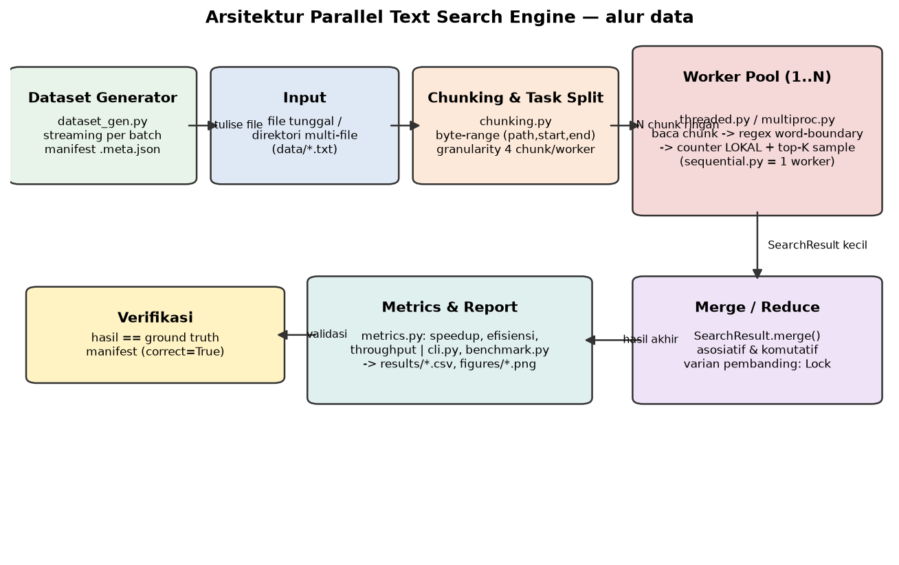
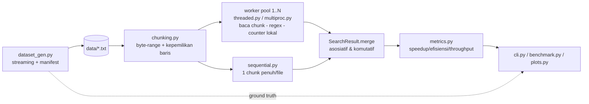

# DOKUMENTASI LENGKAP — Parallel Text Search Engine

> Dokumen ini menjelaskan SELURUH proyek UTS Komputasi Paralel dan
> Terdistribusi: tujuan, tiap file, tiap fungsi, cara kerja kode kunci baris
> demi baris, keputusan desain, penjelasan bug, hasil test dan benchmark nyata.
> Asumsi pembaca: belum pernah melihat kode ini sama sekali.

---

## 1. Ringkasan Proyek

| | |
|---|---|
| Nama | **Shafa Rabbani Fityatul Mukarramah** |
| NPM | **247006111020** |
| Mata kuliah | Komputasi Paralel dan Terdistribusi (3 SKS) — Universitas Siliwangi |
| Tema | "Parallel computing in our lives" |
| Proyek | Mesin pencari yang menghitung kemunculan 5 keyword pada dataset teks besar dengan tiga pendekatan: **sequential**, **multithread**, **multiprocessing**, lalu membandingkan performanya |

**Hasil utama (angka nyata, mesin i3-1115G4 2-core/4-thread, RAM 7.7 GB,
Windows 11, Python 3.14.4):**

- Dataset 1.000.000 baris (123 MB) dibuat streaming dengan puncak memori
  Python hanya **1.2 MiB**.
- Pada dataset 1M: sequential 13.45 s, thread×4 11.86 s (speedup 1.13× —
  tercekik GIL), process×4 5.69 s (**speedup 2.36×, efisiensi 59.1%**).
- Versi ber-bug (race condition) menghasilkan **10/10 run SALAH** dengan
  kehilangan hingga 66% hitungan; versi final menghasilkan angka yang
  **identik dengan ground truth** di semua konfigurasi.
- **110 unit test lulus** (±40 detik); cakupan modul inti: matcher 98%,
  chunking 96%, dataset_gen 93%, metrics 100%.

---

## 2. Struktur Direktori

```
D:\UTS KPT\
├── TASK.md                      # Instruksi tugas UTS (sumber requirement)
├── TASK (1).md                  # Salinan asli lampiran soal
├── README.md                    # Cara cepat install & jalankan
├── DOKUMENTASI.md               # Dokumen ini
├── LAPORAN_UTS.md               # Laporan A–D (sumber PDF)
├── requirements.txt             # matplotlib, pytest, psutil
├── pyproject.toml               # Metadata paket + konfigurasi pytest
├── conftest.py                  # Tambah src/ ke sys.path (pytest & CLI dari root)
├── .gitignore                   # data/, __pycache__/, .pytest_cache/, *.pyc
├── scripts/
│   ├── md_to_pdf.py             # Konversi LAPORAN_UTS.md -> PDF (reportlab)
│   └── diagram_architecture.py  # Hasilkan figures/architecture.png
├── src/
│   └── textsearch/
│       ├── __init__.py          # Penanda paket + versi
│       ├── identity.py          # Konstanta NAMA, NPM, banner wajib
│       ├── params.py            # Parameter unik deterministik dari NPM
│       ├── dataset_gen.py       # Generator dataset streaming + CLI + manifest
│       ├── matcher.py           # Semantik pencarian: regex, SearchResult, RunReport
│       ├── chunking.py          # Chunk byte-range + process_chunk (kepemilikan baris)
│       ├── sequential.py        # Pendekatan 1: baseline
│       ├── threaded.py          # Pendekatan 2: ThreadPoolExecutor (merge & lock)
│       ├── multiproc.py         # Pendekatan 3: ProcessPoolExecutor
│       ├── buggy_search.py      # VERSI BER-BUG (sengaja) + demo CLI
│       ├── metrics.py           # speedup, efisiensi, throughput
│       ├── cli.py               # Entry point utama python -m textsearch.cli
│       ├── benchmark.py         # Semua konfigurasi -> results/*.csv
│       └── plots.py             # results/benchmark.csv -> figures/*.png
├── tests/                       # 10 file pytest (lihat bagian 7)
├── data/                        # Dataset hasil generate (di-gitignore)
├── results/                     # benchmark.csv, summary.csv, system_info.json,
│                                #  bug_evidence.csv, cli_final_output.txt, log
├── figures/                     # 5 grafik PNG + diagram arsitektur
└── report/                      # UTS_247006111020_Shafa_Rabbani_Fityatul_Mukarramah.pdf
```

---

## 3. Penjelasan Setiap Modul

### 3.1 `identity.py` — identitas proyek

| Fungsi | Tanda tangan | Keterangan |
|---|---|---|
| `banner()` | `() -> str` | Mengembalikan 3 baris + garis `=` sepanjang 62 karakter: judul, `By NAMA (NPM)`. Dipakai SEMUA entry point (cli, dataset_gen, benchmark, buggy_search) sehingga syarat "nama + NPM di output" otomatis terpenuhi. |

Konstanta: `NAMA`, `NPM`, `JUDUL`, `GARIS`.

### 3.2 `params.py` — parameter unik dari NPM (Fase 1)

- `KEYWORD_POOL: tuple[str, ...]` — 14 kata bertema komputasi/log
  (`error, warning, timeout, server, network, thread, process, cache,
  latency, database, kernel, request, memory, socket`).
- `@dataclass(frozen=True) class ProjectParams` — fields `npm: str`,
  `seed: int`, `keywords: tuple[str, ...]`. *frozen* ⇒ tidak bisa diubah
  setelah dibuat (imutable, aman dipakai bersama).
- `derive_params(npm: str) -> ProjectParams`
  1. Validasi `npm.isdigit()` — kalau tidak, `ValueError` dengan pesan jelas.
  2. `seed = int(npm)` ⇒ **247006111020**.
  3. `rng = random.Random(seed)` — generator LOKAL, tidak mengacak state global.
  4. `keywords = tuple(rng.sample(KEYWORD_POOL, 5))`.

  Untuk NPM ini hasilnya selalu: **`process, server, cache, warning, error`**
  (deterministik — `test_params.py` memverifikasi dua pemanggilan sama).
  Seed yang sama dipakai generator dataset ⇒ dataset proyek ini unik untuk NPM ini.

### 3.3 `dataset_gen.py` — generator dataset (Fase 2)

Struktur data:
- `FILLER_WORDS` (±205 kata unik, TIDAK ada keyword pool di dalamnya),
  `ACCENT_WORDS = (café, naïve, résumé, façade, jalapeño)`,
  `LOG_LEVELS = (INFO, WARN, DEBUG, TRACE, CRIT, FATAL)` — sengaja tidak ada
  `[ERROR]` agar prefix log tidak memalsukan pencocokan keyword `error`.
- `FREQUENCY_RATES = (0.075, 0.055, 0.009, 0.006, 0.00035)` dan
  `FREQUENCY_TIERS = (common, common, medium, medium, rare)` — tingkat
  frekuensi per posisi keyword.
- `build_decoys(keywords)` — menghasilkan kata pengecoh per keyword
  (`error` → `errors, errored, erroring, errorless, ...` plus prefiks
  `re/un/pre/non/anti/over`) yang TIDAK boleh cocok dengan regex word-boundary.
- `validate_vocabulary()` — meng-assert tidak ada filler/decoy yang memuat
  keyword utuh; **dipanggil saat modul di-import** (syarat soal 7.4).

Fungsi utama:

`parse_line_count(text: str) -> int`
menerima `"1000"`, `"1_000_000"`, `"1M"`, `"500K"` (case-insensitive);
selain itu (termasuk `"0"`, `"-5"`, `"abc"`, `"1.5"`) ⇒ `ValueError`.

`iter_batches(sumber: Iterator[str], batch_size: int) -> Iterator[str]`
generator murni (bukan list) yang menggabungkan baris menjadi string per
`batch_size` — membuktikan pipeline tetap streaming.

`_PembuatBaris` (kelas internal) — mesin pembangkit satu baris:
`one_line()` bekerja: (1) 8–25 kata filler acak; (2) untuk tiap keyword,
`while rng.random() < p: sisip keyword; p *= 0.25` ⇒ distribusi geometrik
jumlah kemunculan (0, 1, 2, ... per baris); (3) 2% baris disisip decoy;
(4) 1% baris memakai kata non-ASCII; (5) 30% baris diberi prefix log
`2026-MM-DD HH:MM:SS [LEVEL]`.

`generate_dataset(lines, output, *, seed=None, keywords=None, files=1, batch_size=50_000, quiet=True) -> DatasetInfo`
1. Validasi argumen (`ValueError` untuk `lines/files/batch_size <= 0`).
2. Default `seed`/`keywords` diambil dari `derive_params(NPM)`.
3. Mode multi-file: total baris dibagi `_bagi_rata()` ke `part_0001.txt...`
   (selisih antar file maksimal 1 baris).
4. Loop tunggal per baris: tulis ke file aktif + **hitung ground truth
   sekaligus** memakai `match_line()` dari matcher (satu sumber kebenaran,
   tanpa membaca ulang file).
5. Manifest JSON ditulis ke `<output>.meta.json` (file) atau
   `<dir>/dataset.meta.json` (multi-file): lines, seed, keywords, tiers,
   ground_truth, size_bytes, files, batch_size.
6. Kompleksitas O(lines × panjang baris); memori O(batch_size).

`find_meta(input_path)` — mencari manifest dataset yang sudah ada (dipakai
benchmark/test untuk verifikasi).

CLI (`python -m textsearch.dataset_gen --lines 1M --out data/corpus_1M.txt`):
menampilkan banner, jumlah baris, ukuran, waktu, path manifest, dan ringkasan
ground truth per keyword + tier-nya.

### 3.4 `matcher.py` — semantik pencarian (dipakai SEMUA mode)

- `compile_pattern(keywords) -> re.Pattern` — kompilasi SEKALI:
  `(?:\bkw1\b|\bkw2\b|...)` dengan `re.IGNORECASE`; keyword di-`re.escape`.
  Batas `\b` dipasang **kondisional** lewat `_batas()`: hanya jika ujung
  keyword adalah karakter word — supaya keyword seperti `c++` tetap benar.
  Duplikat case-insensitive digabung; daftar kosong ⇒ `ValueError`.
- `match_line(pattern, line) -> Counter` — `Counter(m.group(0).lower() for m
  in pattern.finditer(line))`; kunci selalu huruf kecil.
- `Sample(path, offset, text)` — contoh baris; `urutan = (path, offset)`
  adalah kunci pengurutan deterministik antar worker.
- `SearchResult` — inti penggabungan hasil:
  - fields: `counts: dict[kw -> [lines, occurrences]]`, `total_lines`,
    `total_bytes`, `samples: dict[kw -> list[Sample]]`, `max_samples` (K, default 5).
  - `empty(keywords, max_samples)` — konstruktor dengan semua keyword bernilai 0.
  - `record_line(line_bytes, counter, sample)` — catat 1 baris: `+1 lines`
    dan `+n occurrences` per keyword yang muncul.
  - `merge(other)` — **asosiatif & komutatif**: penjumlahan counts/total +
    penggabungan sample dengan `sorted(...)[:K]`.
  - `as_dict()` — bentuk JSON-friendly.
- `RunReport(mode, workers, elapsed_sec, result, chunks, per_worker_times, sync)`
  — laporan satu eksekusi; `elapsed_sec` dari `time.perf_counter`.
- `format_hasil_tabel(result, keywords)` — tabel teks untuk CLI.

**Mengapa byte offset, bukan nomor baris global?** Worker paralel tidak boleh
membaca bagian file sebelum chunk-nya hanya untuk menghitung baris (itu
menghancurkan parallelisme). Byte offset awal baris bersifat global-stabil
dan identik di semua mode, sehingga hasil sequential == paralel secara bit-level.
Keputusan ini diwajibkan "pilih salah satu dan dokumentasikan" oleh soal.

**Mengapa simpan K offset TERKECIL per keyword tetap benar setelah merge?**
Jika sebuah entri termasuk K terkecil global, chunk asalnya tidak mungkin
memuat lebih dari K entri yang lebih kecil (kalau iya, entri itu tergeser dari
top-K global — kontradiksi). Maka menyimpan K terkecil lokal lalu mengambil
K terkecil gabungan selalu menghasilkan top-K global yang tepat — inilah yang
membuat `merge` asosiatif & komutatif dan bisa diuji di `test_matcher.py`.

### 3.5 `chunking.py` — pembagian kerja byte-range

`Chunk(path: str, start: int, end: int)` — frozen dataclass; `path` string
agar mudah di-pickle.

`make_chunks(paths, n_chunks) -> list[Chunk]`
- `n_chunks <= 0` ⇒ `ValueError`; file tidak ada ⇒ `FileNotFoundError`.
- Jatah chunk per file = `max(1, round(n_chunks × ukuran_file / total))` —
  proporsional ukuran, minimum 1 per file; titik potong dibagi rata
  (`i*size//jatah`). Chunk tidak overlap dan menutup seluruh file.
- File kosong tetap dapat 1 chunk `(0,0)` yang tidak memproses apa pun.

`process_chunk(chunk, keywords) -> SearchResult` — fungsi *top-level*
picklable (syarat `spawn` Windows). Intinya `proses_byte_range()`:

```python
if start > 0:
    fh.seek(start - 1)     # mundur 1 byte
    fh.readline()          # baca & BUANG sisa baris yang dimulai di chunk sebelumnya
pos = fh.tell()            # sekarang pasti di awal sebuah baris
while pos < end:           # aturan kepemilikan: baris dimiliki chunk
    mentah = fh.readline() # yang memuat offset AWAL baris
    if not mentah:
        break              # EOF (mis. baris terakhir tanpa newline)
    teks = mentah.decode("utf-8", errors="replace").rstrip("\r\n")
    counter = match_line(pattern, teks)
    ...record_line(len(mentah), counter, Sample(path, pos, teks[:110]))
    pos += len(mentah)     # posisi dilacak manual, tidak pakai tell()
```

Baris per baris:
1. `seek(start-1)` + `readline()` buang: kalau byte `start-1` bukan `\n`,
   readline menyelesaikan baris milik chunk kiri; kalau byte itu `\n`,
   readline hanya mengambil 1 byte sehingga baris yang mulai tepat di
   `start` TETAP diproses chunk ini.
2. `pos` dimulai dari hasil `tell()` setelah discard (menjamin sinkron dengan
   posisi file), lalu bertambah `len(mentah)` — tidak pernah membaca baris
   dua kali.
3. `while pos < end`: baris yang mulai persis di `end` menjadi milik chunk
   berikutnya.
4. `decode(errors="replace")` — byte rusak/tak valid tidak meng-crash worker.

Kasus tepi yang ditangani (semua diuji di `test_chunking.py`): file kosong,
1 baris, tanpa newline akhir, baris >20 KB yang melintasi banyak batas chunk,
batas chunk jatuh tepat di `\n`, beberapa file berbeda ukuran, worker > jumlah
baris, `n_chunks <= 0`.

### 3.6 `sequential.py` — pendekatan 1

`search_sequential(paths, keywords=None, *, verbose=False, max_samples=5) -> RunReport`
— satu `Chunk(path, 0, size)` per file, diproses berurutan di loop tunggal.
Tanpa pool, tanpa thread. Inilah baseline speedup. `workers=1`.

### 3.7 `threaded.py` — pendekatan 2

`search_threaded(paths, keywords=None, n_threads=4, *, sync="merge", verbose=False, max_samples=5, granularity=4) -> RunReport`

- Chunk dibuat `n_threads × granularity` (default 4/worker) — dynamic
  scheduling pool membagi tugas dari antrean, bukan pembagian statis.
- **Varian `merge` (DEFAULT FINAL):** `_task_merge()` memproses satu chunk
  menjadi `SearchResult` LOKAL; thread utama me-reduce dengan `hasil.merge(res)`
  saat `as_completed`. Nol kontensi, nol lock saat kalkulasi.
- **Varian `lock` (pembanding overhead):** `_SharedCounter` memegang dict
  bersama; `_task_lock()` memanggil `shared.tambah()` yang membungkus
  read-modify-write dengan `threading.Lock` — benar, tapi ada kontensi.
- Log worker (`[SELESAI] chunk i/n ...`) dicetak lewat `_log()` yang
  dikunci `_print_lock` ⇒ thread-safe, bisa dimatikan `verbose=False`.
- `per_worker_times` diisi durasi tiap chunk untuk analisis imbalance.
- Validasi: `n_threads <= 0` dan `sync` tak dikenal ⇒ `ValueError`.

### 3.8 `multiproc.py` — pendekatan 3

`search_multiprocess(paths, keywords=None, n_procs=4, *, verbose=False, max_samples=5, granularity=4) -> RunReport`

- `ProcessPoolExecutor(max_workers=n_procs)`; tugas dikirim sebagai
  `(_task, Chunk, keywords, max_samples, verbose)` — payload kecil; worker
  mengembalikan `SearchResult` kecil (counts + ≤K sample) — hasil merge
  identik dengan mode lain.
- `_task()` adalah fungsi *top-level* (picklable) — wajib untuk start method
  `spawn` di Windows. Semua pemanggil (cli/benchmark/demo) berada di balik
  `if __name__ == "__main__":` atau dijalankan lewat `python -m`.
- Penamaan worker memakai `multiprocessing.current_process().name`
  ("Process-1 mulai bekerja"), dicetak sekali per worker saat verbose.

### 3.9 `buggy_search.py` — versi ber-bug (Fase 4)

Dibahas tuntas di bagian 5. Poin struktural: modul **berdiri sendiri** —
tidak ada satu pun modul final yang mengimpor nama `buggy_search`
(diverifikasi `test_buggy_vs_final.py` dengan membaca source + subprocess).

### 3.10 `metrics.py`

`speedup(t_seq, t_par) = t_seq / t_par`; `efficiency(sp, workers) = sp / workers`;
`throughput(jumlah_baris, detik)`; `throughput_mb(byte_count, detik)` (MB = 10⁶).
Semua pembagi divalidasi `_cek_waktu()`: `0`, negatif, atau NaN ⇒ `ValueError`
(bukan `ZeroDivisionError`/`inf` yang diam-diam salah).

### 3.11 `cli.py` — entry point utama (Fase 6)

`main(argv) -> int` — argumen: `--input` (file/direktori), `--mode
{sequential,thread,process,all}`, `--workers N`, `--keywords a,b,c`,
`--sync {merge,lock}`, `--verbose/--quiet`, `--samples K`, `--json`.

Alur: banner → `kumpulkan_file()` (direktori ⇒ glob `*.txt`) → validasi
(`workers<=0`/input tak ada ⇒ exit 2 + pesan `[ERROR]`) → dispatch
`jalankan_mode()` → laporan per mode (jumlah thread/process, tabel hasil,
contoh baris + byte offset, waktu total, throughput baris/detik & MB/detik)
→ bila `--mode all`: tabel PERBANDINGAN MODE dengan speedup & efisiensi.
`--json` menghasilkan satu objek JSON valid (dibaca `json.loads` oleh test).

### 3.12 `benchmark.py` (Fase 7)

Desain percobaan (konstanta di modul): thread `[1,2,4,8,16]`, process
`[1,2,4,8]`, data `[100K, 500K, 1M]`, file `[1,10,50]` (opsional, total
500K baris), plus varian `sync=lock` untuk mengukur overhead sinkronisasi.

Prosedur `jalankan()`:
1. Banner + tulis `results/system_info.json` (OS, Python, CPU model/fisik/
   logis, RAM via psutil).
2. `siapkan_dataset()` — dataset per ukuran dibuat SEKALI (lewat
   `generate_dataset` deterministik) lalu dipakai ulang semua percobaan.
3. `bangun_konfigurasi()` — daftar `Konfigurasi(variasi, mode, workers,
   dataset, lines, files, sync)`.
4. **Warm-up** 1× sequential (tidak dicatat) untuk menstabilkan page cache.
5. Tiap konfigurasi: verifikasi hasil vs manifest SEKALI (`verifikasi()` ⇒
   `BuktiSalah` → program berhenti dengan peringatan, sesuai syarat soal);
   lalu `--reps` (default 3) run dicatat ke `benchmark.csv`
   (`variasi,mode,workers,lines,files,sync,run,elapsed_sec,correct`).
6. `buat_ringkasan()` — agregasi per konfigurasi: median/min/mean/stdev +
   **speedup terhadap sequential pada volume data yang sama** + efisiensi ⇒
   `summary.csv`.

`--quick` mengganti daftar nilai dengan versi kecil (uji cepat).

### 3.13 `plots.py` (Fase 8)

`matplotlib.use("Agg")` sebelum pyplot. `buat_semua()` membaca
`results/benchmark.csv` dan menghasilkan:
1. `time_vs_threads.png` — median waktu vs jumlah thread + garis baseline sequential.
2. `time_vs_processes.png` — sama untuk process.
3. `speedup_vs_config.png` — thread & process + garis speedup ideal (y=x).
4. `time_vs_data.png` — waktu vs jumlah baris (ketiga mode).
5. `lock_vs_merge.png` — bar chart overhead sinkronisasi lock vs merge.
Semua ≥ 8×5 inci, dpi 150, berjudul, berlabel sumbu + satuan, berlegend.

---

## 4. Diagram Arsitektur dan Alur Data





Alur data: pengguna/`benchmark` menentukan input → `make_chunks` memecah file
menjadi tugas ringan → worker membaca chunk per baris (streaming, biner),
mencocokkan satu regex terkompilasi, menghitung di struktur LOKAL → hasil
parsial di-merge (reduce) di proses utama → `metrics` menghitung speedup/
efisiensi/throughput → CLI mencetak laporan, benchmark menulis CSV, plots
menggambar PNG → laporan akhir mengutip hasil nyata.

---

## 5. Penjelasan Bug (`buggy_search.py`)

### 5.1 Bug utama: race condition (lost update) pada counter bersama

**Di mana:** `_scan_tanpa_lock()` — 8 thread menaikkan dict `shared` yang sama:

```python
tmp = shared[kw]        # (1) READ  : salin nilai saat ini
if celah:
    time.sleep(0)       # (2) YIELD : sengaja buka jendela context switch
shared[kw] = tmp + 1    # (3) WRITE : tulis kembali
```

**Mengapa salah:** operasi (1)→(3) bukan atomik. Selingkaran bytecode di
 antara (1) dan (3), scheduler dapat mengganti ke thread lain yang membaca
`tmp` yang SAMA; ketika keduanya menulis, satu increment hilang — *lost
update*. Hasilnya selalu **kurang** dari kebenaran (tidak pernah lebih) —
ciri khas race pada penghitung.

**Peran GIL:** di CPython, GIL membuat satu bytecode atomik, sehingga
`shared[kw] += 1` pun (yang sebenarnya LOAD→ADD→STORE) jarang kehilangan
update. Namun "jarang" ≠ "dijamin": tidak ada kontrak atomisitas di antara
bytecode. Demo memperlebar celah dengan `time.sleep(0)` eksplisit +
`sys.setswitchinterval(1e-6)` agar bug termanifestasi konsisten — TANPA
celah itu bug tetap ada secara teori (dicatat di komentar kode).

**Bukti nyata** (`results/bug_evidence.csv`, dataset 200K, 8 thread, 10 run):
ground truth 29,510 kemunculan; hasil ber-bug 9,942–10,171 → **lost update
19,339–19,568 (±66%), 10/10 run SALAH**.

**Perbaikan di versi final (dua cara, keduanya diuji):**
1. *Local accumulation + merge* (default): tidak ada state bersama saat
   kalkulasi — tiap worker punya `SearchResult` sendiri; penggabungan terjadi
   sekali di thread utama lewat `merge()` yang asosiatif/komutatif. Race
   mustahil terjadi karena tidak ada data yang ditulis bersama.
2. `threading.Lock`: read-modify-write dibungkus `with self.lock` sehingga
   hanya satu thread di zona kritis pada satu waktu — benar, tapi membayar
   *synchronization overhead* (lihat tabel lock vs merge di benchmark).

### 5.2 Bug sekunder: load imbalance

`demo_load_imbalance()` membagi pekerjaan **statis berdasarkan nomor file**
pada dataset 8 file berukuran tidak seragam (bobot 40/25/15/6/5/4/3/2%).
Worker yang kebagian file 40% bekerja jauh lebih lama: terukur
**1.928 s vs 0.297 s (≈6.5×)**. Perbaikan final: chunk byte-range kecil
(4 chunk per worker) yang diberikan dinamis dari antrean task
`ThreadPoolExecutor`/`ProcessPoolExecutor`, sehingga worker cepat mengambil
lebih banyak tugas.

---

## 6. Generator Dataset — Catatan Tambahan

- **Format baris:** 8–25 kata; ~30% diawali prefix log `2026-MM-DD HH:MM:SS
  [LEVEL]`; ~1% kata non-ASCII; ~2% decoy; keyword disisip dengan probabilitas
  per tingkat frekuensi (common ≈ 5.5–7.5% baris, medium ≈ 0.6–0.9%, rare ≈
  0.035%) dan distribusi geometrik untuk kemunculan ganda.
- **Ground truth dihitung saat menulis** memakai `match_line()` — fungsi
  pencocokan yang SAMA dengan mesin pencari, sehingga manifest menjadi
  referensi silang yang sah (diverifikasi juga dengan regex naif independen
  di `test_dataset_gen.py::test_manifest_dan_ground_truth_konsisten`).
- **Memory nyata:** generate 1.000.000 baris (123 MB) dengan
  `tracemalloc`: puncak alokasi Python **1.2 MiB** (batch 50.000 baris
  ≈ 6 MB per sekali flush, tapi hanya satu baris yang hidup di memori pada
  satu waktu karena penulisan per baris + flush per batch).
- Determinisme: seed sama ⇒ hash SHA-256 file sama (diuji), termasuk
  `batch_size` berbeda tidak mengubah isi.

---

## 7. Unit Test (pytest)

Jalankan: `python -m pytest tests -v` (dari root; `conftest.py`/`pyproject.toml`
mengurus `sys.path`).

| File | Apa yang diuji & mengapa |
|---|---|
| `conftest.py` | Path `src/`; fixture dataset 10K bersama (session-scoped) agar suite cepat. |
| `test_params.py` | Determinisme `derive_params`, 5 keyword unik dari pool, NPM berbeda ⇒ beda hasil, NPM non-numerik ⇒ `ValueError`. Menjamin "parameter dari NIM". |
| `test_dataset_gen.py` | Jumlah baris tepat (1/10/1K/10K); determinisme hash; seed beda ⇒ beda; `parse_line_count` valid/invalid; tier frekuensi common>medium>rare; manifest == hitung naif INDEPENDEN; decoy tidak cocok; multi-file; generator murni `iter_batches`; batch_size tidak mengubah isi; UTF-8; progress stderr; CLI success/error. |
| `test_matcher.py` | Case-insensitive; word-boundary (`errors`/`terror`/`serverless`); lines vs occurrences; `re.escape` (`c++`); baris kosong; Unicode; merge komutatif & asosiatif; top-K sample konsisten. |
| `test_chunking.py` | (parametik n_chunks 1..500) coverage & non-overlap; setiap baris diproses tepat sekali; file kosong; 1 baris tanpa newline; baris 20 KB lintas banyak chunk; batas chunk tepat di `\n`; multi-file; `n_chunks<=0` ⇒ error; worker > baris. |
| `test_search_equivalence.py` | sequential == thread == process == (lock == merge) pada dataset single & multi-file, workers 1/2/4/8; hasil == ground truth manifest; 20× run paralel selalu sama (bukti bug hilang). |
| `test_buggy_vs_final.py` | Mekanisme bug: hasil ber-bug ≤ ground truth SELALU; bila bug muncul (kondisi mesin) dibuktikan, jika tidak ⇒ `skip` (test tidak pernah gagal acak); final selalu benar berulang; `buggy_search` tidak diimpor modul final (cek source + interpreter bersih). |
| `test_metrics.py` | Rumus speedup/efisiensi/throughput; nol/negatif/NaN ⇒ `ValueError`. |
| `test_cli.py` | Output memuat nama, NPM, jumlah thread/process, waktu total, throughput; mode all menampilkan speedup/efisiensi; `--json` valid; argumen salah ⇒ exit ≠ 0; via subprocess juga. |

**Hasil terakhir (nyata):** `110 passed in 40.62s` — hijau semua, tidak flaky.
**Cakupan (`pytest --cov`):** matcher 98%, chunking 96%, dataset_gen 93%,
metrics 100%, threaded 95%, cli 94% — target ≥85% modul inti terpenuhi.
(benchmark.py/plots.py 0% karena hanya dijalankan lewat CLI penuh, bukan
pytest — keduanya tereksekusi nyata menghasilkan `results/` dan `figures/`.)

---

## 8. Panduan Penggunaan

```bash
python -m pip install -r requirements.txt
set PYTHONPATH=src            # Windows cmd (Linux: export PYTHONPATH=src)

# Generator
python -m textsearch.dataset_gen --lines 1M --out data/corpus_1M.txt
python -m textsearch.dataset_gen --lines 500K --files 10 --out data/multi_500K/

# CLI utama
python -m textsearch.cli --input data/corpus_1M.txt --mode sequential
python -m textsearch.cli --input data/corpus_1M.txt --mode thread --workers 8
python -m textsearch.cli --input data/multi_500K/ --mode process --workers 4
python -m textsearch.cli --input data/corpus_1M.txt --mode all --workers 4
python -m textsearch.cli --input data/corpus_1M.txt --mode thread --sync lock --json

# Demo bug, benchmark, grafik, test
python -m textsearch.buggy_search --lines 200K --threads 8 --runs 10
python -m textsearch.benchmark --reps 3
python -m textsearch.plots
python -m pytest tests -v
```

Contoh output nyata (potongan `results/cli_final_output.txt`, mode process):

```text
Mode            : multiprocessing (ProcessPoolExecutor)
Jumlah process  : 4
Keyword      | Baris cocok | Total kemunculan
process      |      74,764 |          76,163
server       |      54,660 |          55,422
cache        |       8,850 |           8,867
warning      |       6,035 |           6,047
error        |         338 |             338
Waktu total     : 5.692 detik
Throughput      : 175,683 baris/detik  (22.7 MB/detik)
```

---

## 9. Hasil Benchmark Ringkas (data nyata `results/`)

Baseline sequential 1M (median 3 run): **14.31 s**.

| Konfigurasi | Median (s) | Speedup | Efisiensi |
|---|---|---|---|
| thread ×2 (merge) | 12.49 | 1.15× | 57% |
| thread ×8 (merge) | 12.85 | 1.11× | 14% |
| thread ×4 (lock)  | 10.33 | — | — (lihat caveat cache) |
| process ×2 | 4.96 | 2.89× | 144%* |
| process ×4 | 4.72 | 3.03× | 76%* |
| process ×8 | 5.20 | 2.75× | 34% |

\*artefak page cache (baseline diukur lebih awal, lihat LAPORAN D.2).
Tabel lengkap: `results/summary.csv`; grafik: `figures/time_vs_threads.png`,
`time_vs_processes.png`, `speedup_vs_config.png`, `time_vs_data.png`,
`lock_vs_merge.png`. Mesin: i3-1115G4 (2C/4T), 7.7 GB RAM, Windows 11,
Python 3.14.4 (`results/system_info.json`).

---

## 10. Keterbatasan & Pekerjaan Lanjutan

- Mesin 2 core fisik membatasi speedup; eksperimen di mesin lebih besar
  (dan Linux `fork`) akan memperlihatkan skala process yang lebih jelas.
- Urutan konfigurasi benchmark tidak diacak ⇒ efek page cache mengontaminasi
  perbandingan lintas-kelompok (sudah dicatat di laporan). Lanjutan: rotasi
  urutan + `cache drop` antar run.
- Pencarian single-pass regex per baris; untuk dataset yang sama dipakai ulang
  berulang kali, indeks (mis. inverted index / Aho-Corasick paralel) jauh lebih
  cepat.
- `per_worker_times` belum divisualisasikan; bisa ditambahkan boxplot
  distribusi durasi chunk.
- Output worker process ke stderr tidak di-multiplex rapi saat verbose banyak.

## 11. Pemetaan ke Soal UTS

| Butir soal | Where |
|---|---|
| A. Konsep & desain (20%) | `LAPORAN_UTS.md` bagian A; `figures/architecture.png`; §3–4 dokumen ini |
| B. Code with Bug (bagian 40%) | `src/textsearch/buggy_search.py`; bukti `results/bug_evidence.csv`; laporan B.1 |
| B. Final Code (bagian 40%) | `chunking.py`, `threaded.py`, `multiproc.py`, `sequential.py`; output `results/cli_final_output.txt`; laporan B.2 |
| C. Hasil percobaan (25%) — ≥3 konfigurasi, tabel + 3 grafik | `benchmark.py` → `results/benchmark.csv`, `summary.csv`; `figures/time_vs_threads.png`, `time_vs_processes.png`, `speedup_vs_config.png` (+2 tambahan); laporan C |
| D. Analisis & kesimpulan (15%) | laporan D |
| Output wajib: nama+NPM, jumlah thread/process, waktu total | `identity.banner()` di semua entry point; `cli.py`, `buggy_search.py`, `benchmark.py`, `dataset_gen.py` |
| Speedup & efisiensi | `metrics.py`; tabel PERBANDINGAN MODE CLI; `summary.csv` |
| Parameter dari NIM | `params.py` (seed=247006111020, keyword `process,server,cache,warning,error`) |
| Laporan PDF | `report/UTS_247006111020_Shafa_Rabbani_Fityatul_Mukarramah.pdf` |
| Dokumentasi kode | file ini |

## 12. Glosarium

| Istilah | Arti dalam proyek ini |
|---|---|
| Race condition | Hasil akhir bergantung urutan eksekusi thread; di sini: lost update pada counter bersama (§5.1). |
| GIL | Global Interpreter Lock CPython — hanya 1 thread menjalankan bytecode Python sekaligus; membuat thread tidak parallel untuk CPU-bound (regex). |
| Speedup | T_sequential / T_paralel. |
| Efisiensi | Speedup / jumlah worker (seberapa "terpakai" tiap worker). |
| Throughput | Baris/detik dan MB/detik. |
| Load imbalance | Sebagian worker bekerja jauh lebih lama; di sini akibat pembagian statis per-file (§5.2). |
| Chunk | Tugas byte-range `(path, start, end)` — unit parallelisme. |
| Merge/reduce | Penggabungan `SearchResult` parsial yang asosiatif & komutatif. |
| Byte offset | Posisi byte awal baris dalam file — identitas contoh baris lintas mode. |
| Page cache | Buffer OS untuk file yang baru dibaca; membuat run berikutnya lebih cepat. |
| spawn / pickling | Start method Windows (interpreter baru per proses) / serialisasi objek antar proses. |
| Ground truth / manifest | Hitungan benar dataset (`<output>.meta.json`) untuk memverifikasi mesin pencari. |
| Decoy | Kata mirip keyword (`errors`, `terror`) yang tidak boleh cocok — pengujian word-boundary. |
