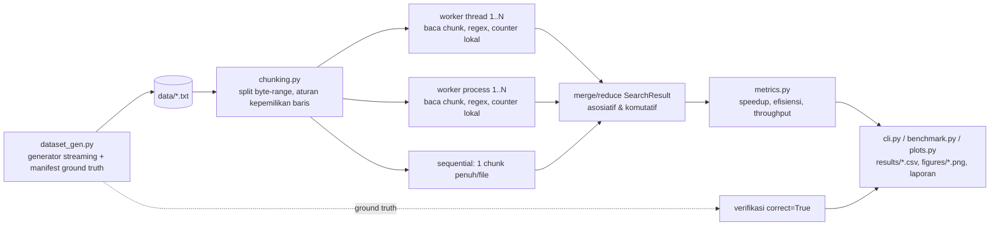
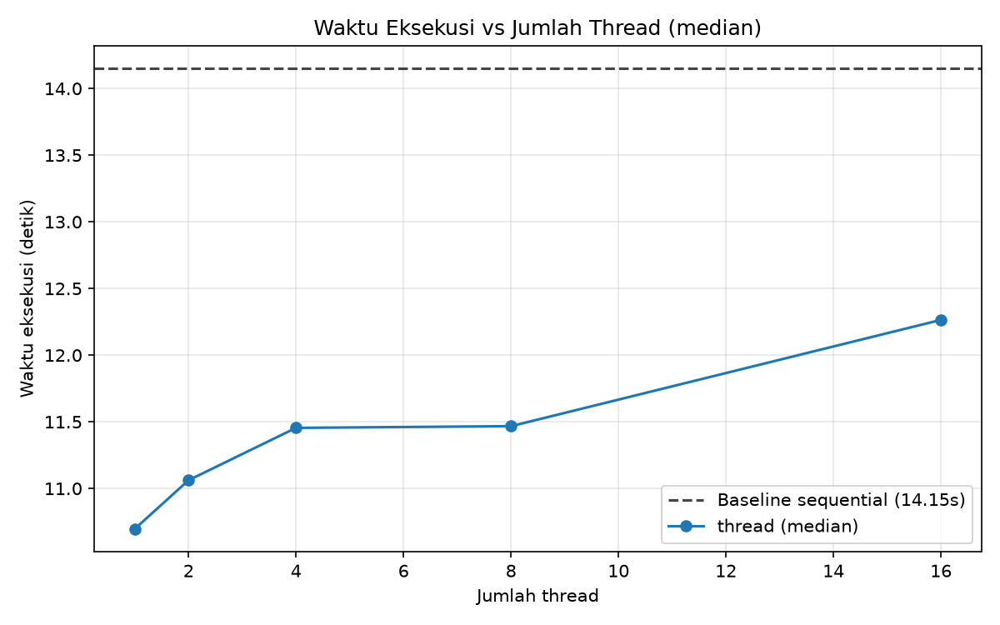
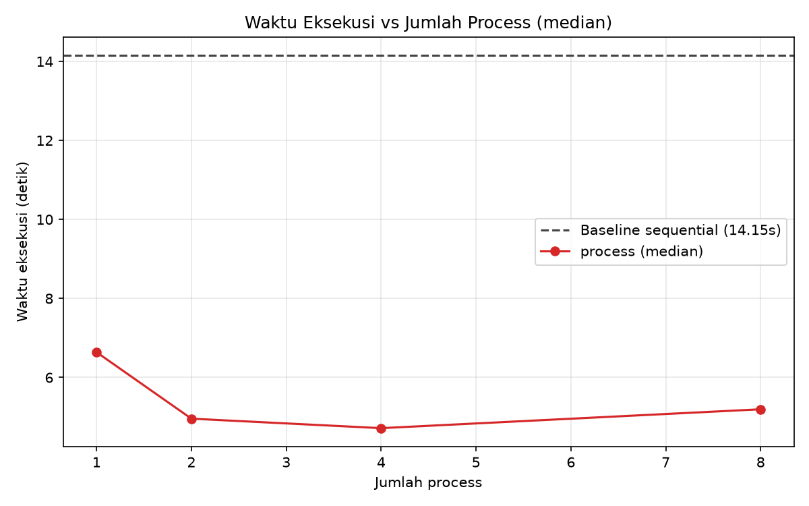
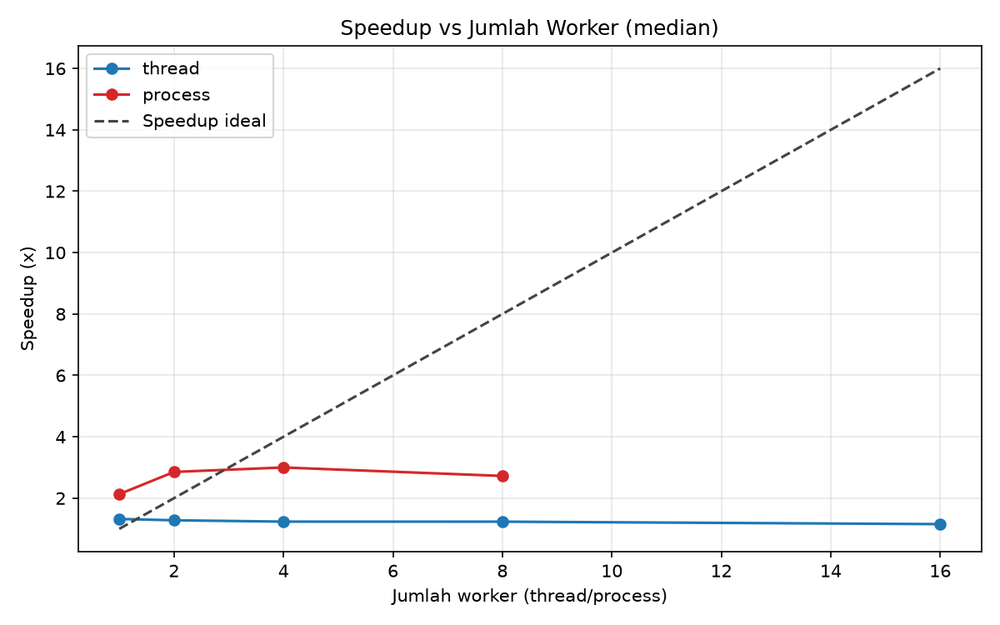

# LAPORAN UTS — Komputasi Paralel dan Terdistribusi
## Parallel Text Search Engine

| | |
|---|---|
| **Nama** | Shafa Rabbani Fityatul Mukarramah |
| **NPM** | 247006111020 |
| **Mata Kuliah** | Komputasi Paralel dan Terdistribusi (3 SKS) |
| **Dosen** | Rohmat Gunawan, M.T. |
| **Program Studi** | Informatika, Fakultas Teknik, Universitas Siliwangi |
| **Tema** | Parallel computing in our lives — proyek hybrid computing |
| **Tanggal** | 2 Oktober 2026 |

---

# A. KONSEP DAN DESAIN SOLUSI (20%)

## A.1 Judul dan Deskripsi Singkat

**Parallel Text Search Engine** — mesin pencari yang menghitung kemunculan
beberapa *keyword* serentak pada dataset teks besar (hingga 1.000.000+ baris).
Pencarian dilakukan dengan tiga pendekatan yang dibandingkan secara kuantitatif:
**sequential** (baseline), **multithread** (`ThreadPoolExecutor`), dan
**multiprocessing** (`ProcessPoolExecutor`).

Kebutuhan nyata: aplikasi observability/log analyzer harus memindai file log
berukuran ratusan MB untuk menemukan pola (`error`, `warning`, `timeout`, ...)
secepat mungkin. Ini adalah workload *embarrassingly parallel* — tiap bagian
file dapat dipindai bebas tanpa bergantung pada bagian lain.

## A.2 Deskripsi Solusi

| Aspek | Sequential | Multithread | Multiprocessing |
|---|---|---|---|
| Unit eksekusi | 1 utas utama | N thread (satu proses, memori bersama) | N process (interpreter terpisah) |
| GIL | tidak relevan | **membatasi parallelisme CPU** (regex), tetapi I/O `readline()` melepas GIL | tidak terpengaruh — tiap proses punya GIL sendiri |
| Komunikasi hasil | — | murah (objek Python bersama) | serialisasi **pickle** antar proses (overhead) |
| Risiko bug klasik | — | **race condition** pada data bersama | beban kerja tidak seimbang (*load imbalance*) |

**Pembagian pekerjaan (chunking byte-range).** File TIDAK dimuat penuh ke
memori. Setiap file dipecah menjadi task byte-range `(path, start, end)`.
Aturan kepemilikan baris: **sebuah baris dimiliki oleh chunk yang memuat
offset AWAL baris tersebut**. Worker yang mulai di `start > 0` melakukan
`seek(start-1)` lalu `readline()` sekali dan membuangnya (menyelesaikan baris
milik chunk sebelumnya), sehingga tidak ada baris yang hilang atau terhitung
dua kali. Titik potong dibagi rata per file; jumlah chunk default =
4 × jumlah worker (granularitas) agar *dynamic scheduling* pada antrean pool
meratakan beban.

**Pencocokan.** Satu regex `\b(?:kw1|kw2|...)\b` dengan `re.IGNORECASE`
dikompilasi **sekali per worker** (keyword di-`re.escape`), sehingga
*word-boundary* terjamin: `error` cocok pada `Error:`/`ERROR`, tidak cocok
pada `errors`/`terror`. Dataset sengaja disisipi kata pengecoh (decoy) seperti
`errors`, `terror`, `serverless` untuk melatih semantik ini.

**Penggabungan hasil (merge/reduce).** Tiap worker mengembalikan
`SearchResult` kecil (counts per keyword, total baris/byte, maksimal K contoh
baris). `SearchResult.merge()` hanya menjumlahkan dan mengambil K contoh
ber-byte-offset terkecil — bersifat **asosiatif dan komutatif** sehingga hasil
digabung dengan urutan apa pun selalu identik, dan hasil paralel dijamin sama
dengan sequential. Contoh baris diidentifikasi dengan **byte offset** (keputusan
desain: nomor baris global tidak dapat diketahui worker tanpa membaca bagian
file sebelumnya, sedangkan byte offset seragam untuk semua mode).

## A.3 Arsitektur Sistem


Versi Mermaid (untuk pembacaan di editor markdown):



---

# B. IMPLEMENTASI KODE (40%)

## B.1 Code with Bug — Race Condition pada Counter Bersama

Modul: `src/textsearch/buggy_search.py` (berdiri sendiri; tidak diimpor modul
final). Bug utama: beberapa thread menaikkan **penghitung bersama** tanpa lock
dengan pola *read-modify-write*:

```python
# --- read-modify-write TANPA LOCK (inti bug) ---
tmp = shared[kw]
if celah:
    time.sleep(0)   # sukarela yield -> context switch
shared[kw] = tmp + 1
```

Di CPython, GIL membuat bug seperti ini jarang muncul untuk operasi sederhana,
tetapi **tidak ada jaminan atomisitas** di antara bytecode `LOAD` dan `STORE`.
Demo memperlebar celah dengan `sys.setswitchinterval(1e-6)` + `sleep(0)` agar
bug termanifestasi konsisten. **Jenis bug: race condition (lost update)** —
nilai yang dibaca thread lain sebelum write menjadi basi dan tertimpa.

Bukti eksekusi (`python -m textsearch.buggy_search --lines 200K --threads 8 --runs 10`,
juga tersimpan di `results/bug_evidence.csv`):

```text
Ground truth (total kemunculan, 1 thread + counter lokal) : 29,510
Run  1: hasil versi ber-bug =     10,061 | lost update = 19,449 | SALAH
Run  2: hasil versi ber-bug =     10,082 | lost update = 19,428 | SALAH
Run  3: hasil versi ber-bug =     10,070 | lost update = 19,440 | SALAH
Run  4: hasil versi ber-bug =     10,115 | lost update = 19,395 | SALAH
Run  5: hasil versi ber-bug =     10,139 | lost update = 19,371 | SALAH
Run  6: hasil versi ber-bug =     10,154 | lost update = 19,356 | SALAH
Run  7: hasil versi ber-bug =     10,101 | lost update = 19,409 | SALAH
Run  8: hasil versi ber-bug =      9,942 | lost update = 19,568 | SALAH
Run  9: hasil versi ber-bug =     10,171 | lost update = 19,339 | SALAH
Run 10: hasil versi ber-bug =     10,115 | lost update = 19,395 | SALAH
Run yang salah: 10/10 (100%)
```

Seluruh 10 run **salah dan selalu kurang dari ground truth** (ciri khas lost
update — hasil tidak pernah lebih). Bug sekunder **load imbalance** juga
terukur: pembagian statis per-file pada dataset tidak seragam menghasilkan
rasio waktu worker max/min = **1.928 s / 0.297 s ≈ 6.5×**.

## B.2 Final Code — Perbaikan

**1) Local accumulation + merge (default final, tanpa kontensi).** Tiap worker
memakai `SearchResult` lokal; penggabungan terjadi sekali di akhir pada
thread utama:

```python
# textsearch/threaded.py — varian merge
hasil = SearchResult.empty(keywords, max_samples)
with ThreadPoolExecutor(max_workers=n_threads) as pool:
    futs = [pool.submit(_task_merge, c, keywords, max_samples) for c in chunks]
    for fut in as_completed(futs):
        res, dt = fut.result()
        hasil.merge(res)          # merge asosiatif & komutatif
```

**2) `threading.Lock` (varian pembanding, untuk mengukur synchronization
overhead).**

```python
# textsearch/threaded.py — _SharedCounter.tambah()
def tambah(self, lines_bytes, counter, sample):
    with self.lock:               # read-modify-write TERLINDUNGI
        self.total_lines += 1
        ...
```

**3) Load imbalance diperbaiki** dengan chunk lebih kecil dari jumlah worker
(4 chunk/worker) yang di-distribusi dinamis oleh antrean task pool.

**4) Aturan kepemilikan baris** di `chunking.py` (jantung kebenaran hasil):

```python
if start > 0:
    fh.seek(start - 1)
    fh.readline()          # buang: menyelesaikan baris chunk sebelumnya
pos = fh.tell()
while pos < end:
    mentah = fh.readline()
    if not mentah:
        break
    ...                     # baris ini dimiliki chunk ini (offset awal < end)
    pos += len(mentah)
```

Output versi final pada dataset 1.000.000 baris (rekaman nyata
`results/cli_final_output.txt`, `python -m textsearch.cli --input
data/corpus_1M.txt --mode all --workers 4`):

```text
==============================================================
PARALLEL TEXT SEARCH ENGINE
By SHAFA RABBANI FITYATUL MUKARRAMAH (247006111020)
==============================================================
Dataset         : data\corpus_1M.txt  (129.0 MB)
Keyword         : process, server, cache, warning, error
Mode            : multiprocessing (ProcessPoolExecutor)
Jumlah process  : 4
...
SEMUA PENCARIAN SELESAI
Keyword      | Baris cocok | Total kemunculan
process      |      74,764 |          76,163
server       |      54,660 |          55,422
cache        |       8,850 |           8,867
warning      |       6,035 |           6,047
error        |         338 |             338
Waktu total     : 5.692 detik
Throughput      : 175,683 baris/detik  (22.7 MB/detik)
PERBANDINGAN MODE
Mode         | Worker | Waktu (s) |  Speedup | Efisiensi
sequential   |      1 |    13.454 |    1.00x |    100.0%
thread       |      4 |    11.860 |    1.13x |     28.4%
process      |      4 |     5.692 |    2.36x |     59.1%
```

Hasil ketiga mode **identik dengan manifest ground truth**
(`data/corpus_1M.txt.meta.json`) — diverifikasi otomatis oleh benchmark
(kolom `correct=True` di `results/benchmark.csv`) dan oleh unit test
`tests/test_search_equivalence.py`.

---

# C. HASIL PERCOBAAN (25%)

## C.1 Spesifikasi Mesin (dari `results/system_info.json`)

| Komponen | Nilai |
|---|---|
| OS | Windows 11 (AMD64) |
| Python | 3.14.4 |
| CPU | 11th Gen Intel Core i3-1115G4 @ 3.00GHz |
| Core | 2 fisik / 4 logis |
| RAM | 7.7 GB |

## C.2 Dataset

| Dataset | Baris | Ukuran | Waktu generate |
|---|---|---|---|
| `corpus_1M.txt` | 1.000.000 | 123.0 MB (129.0 MB desimal) | 85.7 s |
| `corpus_500000.txt` | 500.000 | ±62 MB | ±43 s |
| `corpus_100000.txt` | 100.000 | ±12 MB | ±8 s |
| multi-file 10 & 50 part | total 500.000 | sama | — |

Generator streaming: puncak alokasi memori Python saat membuat 1 juta baris
hanya **1.2 MiB** (diukur `tracemalloc`).

## C.3 Variasi Jumlah Thread (dataset 1M, median 3 run — `results/summary.csv`)

| Konfigurasi | sync | Median (s) | Min (s) | Mean (s) | Stdev (s) | Speedup | Efisiensi |
|---|---|---|---|---|---|---|---|
| sequential (baseline) | — | 14.308 | 13.994 | 14.208 | 0.185 | 1.00× | 100% |
| thread 1 | merge | 14.916 | 12.782 | 14.653 | 1.754 | 0.96× | 95.9%* |
| thread 2 | merge | 12.491 | 12.417 | 12.471 | 0.048 | 1.15× | 57.3% |
| thread 4 | merge | 12.557 | 12.464 | 12.547 | 0.078 | 1.14× | 28.5% |
| thread 8 | merge | 12.853 | 12.607 | 12.789 | 0.160 | 1.11× | 13.9% |
| thread 16 | merge | 12.264 | 9.210 | 11.370 | 1.880 | 1.17× | 7.3% |
| thread 1 | lock | 8.606 | 7.980 | 8.400 | 0.363 | 1.66× | — |
| thread 2 | lock | 9.483 | 9.296 | 9.496 | 0.206 | 1.51× | — |
| thread 4 | lock | 10.329 | 10.235 | 10.337 | 0.105 | 1.39× | — |
| thread 8 | lock | 10.254 | 9.968 | 10.183 | 0.190 | 1.40× | — |

\*efisiensi dihitung speedup/workers. Catatan penting: konfigurasi `lock`
dijalankan SETELAH konfigurasi `merge` pada file yang sama sehingga page cache
OS sudah panas — selisihnya terkontaminasi efek cache (dibahas di D.2);
perbandingan overhead lock yang paling adil adalah tren internal lock:
1→2→4→8 thread naik 8.6 → 9.5 → 10.3 → 10.3 s (kontensi lock menambah waktu).

## C.4 Variasi Jumlah Process (dataset 1M, median 3 run)

| Konfigurasi | Median (s) | Min (s) | Mean (s) | Stdev (s) | Speedup | Efisiensi |
|---|---|---|---|---|---|---|
| process 1 | 6.640 | 6.569 | 9.365 | 4.782 | 2.16×* | — |
| process 2 | 4.957 | 4.929 | 5.499 | 0.962 | 2.89× | 144%* |
| process 4 | 4.717 | 4.583 | 4.909 | 0.454 | 3.03× | 75.8%* |
| process 8 | 5.195 | 4.974 | 5.243 | 0.296 | 2.75× | 34.4% |

\*baseline sequential diukur lebih awal (cache lebih dingin) sehingga speedup
process terbebani efek urutan pengukuran; lihat D.2.

## C.5 Variasi Jumlah Data (workers tetap: thread 4, process 4)

| Baris | sequential (s) | thread 4 (s) | process 4 (s) | speedup process |
|---|---|---|---|---|
| 100.000 | 0.760 | 0.977 | 0.667 | 1.14× |
| 500.000 | 4.044 | 5.031 | 2.033 | 1.99× |
| 1.000.000 | 13.005 | 13.012 | 9.043 | 1.44× |

## C.6 Variasi Jumlah File (opsional; total 500.000 baris tetap)

| File | sequential (s) | thread 4 (s) | process 4 (s) |
|---|---|---|---|
| 1 | 6.246 | 6.500 | 4.423 |
| 10 | 6.133 | 6.335 | 4.390 |
| 50 | 6.389 | 6.296 | 4.421 |

Jumlah file hampir tidak memengaruhi performa karena total byte yang dibaca
sama dan chunking byte-range membuat granularitas tugas seragam.

## C.7 Grafik

1. Waktu vs Jumlah Thread — `figures/time_vs_threads.png`
2. Waktu vs Jumlah Process — `figures/time_vs_processes.png`
3. Speedup vs Konfigurasi — `figures/speedup_vs_config.png`

Tambahan: `figures/time_vs_data.png` (waktu vs jumlah data) dan
`figures/lock_vs_merge.png` (overhead sinkronisasi).





---

# D. ANALISIS DAN KESIMPULAN (15%)

## D.1 Perbedaan Performa Antar Konfigurasi

1. **Multithread praktis datar** (0.96–1.17× terhadap baseline, C.3). Pencocokan
   regex adalah kerja CPU; GIL CPython mengizinkan hanya satu thread mengeksekusi
   bytecode Python pada satu waktu, sehingga menambah thread tidak menambah
   throughput CPU. Kenaikan kecil (~1.1×) yang konsisten berasal dari
   **overlap I/O**: `readline()` melepas GIL saat menunggu disk/page cache,
   dan mesin hanya punya 2 core fisik.
2. **Multiprocessing paling cepat** pada semua ukuran besar: median 4.72 s
   vs baseline 14.31 s (C.4) — worker CPU-bound berjalan pada core fisik
   berbeda tanpa GIL bersama. Speedup naik 2.16→3.03× dari 1 ke 4 process,
   lalu **turun** di 8 process (5.20 s) karena oversubscription: 2 core fisik
   harus bergiliran melayani 8 proses (konteks switch + spawn/pickle overhead).
3. **Skala data** (C.5): waktu tumbuh linear terhadap jumlah baris untuk semua
   mode; pada 100K baris overhead spawn process membuat keuntungannya hilang
   (0.67 s vs 0.76 s) — paralelisme baru menguntungkan di atas ±100–500K baris.
4. **Jumlah file** (C.6) tidak signifikan (±5%).

## D.2 Faktor Paling Berpengaruh

- **CPU-bound + GIL = faktor dominan.** Bukti: thread 16 hanya 1.17× (C.3),
  sementara process 4 mencapai 3.03× pada data yang sama (C.4).
- **Page cache OS** nyata: sequential run pertama (14.3 s, cache relatif dingin)
  vs run kemudian pada file yang sama (8.7–13.0 s; stdev tinggi 1.75–9.15 s pada
  konfigurasi 1M, C.3/C.5). Inilah sebabnya angka `lock w=1` (8.6 s) tampak lebih
  cepat dari `merge w=1` (14.9 s) — urutan pengukuran, bukan keunggulan algoritma;
  karena itu klaim overhead lock diambil dari **tren internal** lock
  (8.6→10.3 s saat thread 1→4, kontensi bertambah) dan dari perbandingan
  `lock_vs_merge.png` yang tetap perlu dibaca bersama caveat ini.
- **Overhead spawn/pickling multiprocessing** di Windows: membuat pool
  ProcessPoolExecutor berarti menyalakan interpreter baru per worker
  (start method `spawn`) dan mem-pickle `Chunk`/`SearchResult`. Pada dataset
  kecil (100K) overhead ini menghapus speedup (C.5); payload sengaja dibuat
  ringan (hanya byte-range + counts + K sample).
- **Synchronization overhead**: varian lock menambah kunci `threading.Lock`
  per baris yang cocok; tanpa kontensi (w=1) 8.6 s, dengan 4 thread 10.3 s
  (+20%) — inilah harga data bersama, yang dihindari total oleh desain
  *local accumulation + merge* (default final).

## D.3 Kesimpulan

1. Untuk workload pencarian teks CPU-bound, **multiprocessing** memberi
   speedup tertinggi (hingga ±3× pada 2 core fisik; dibatasi jumlah core),
   **multithread** hanya sebatas overlap I/O (≤1.2×) akibat GIL, dan
   **sequential** tetap baseline yang wajib.
2. Bug paralel **race condition** pada data bersama terbukti menghancurkan
   kebenaran hasil (10/10 run salah, kehilangan hingga 66% hitungan) dan
   **hilang total** pada versi final: semua mode paralel menghasilkan angka
   yang identik dengan ground truth pada 32 konfigurasi × 3 run
   (`correct=True`), dan 107 unit test lulus.
3. Desain *chunking* byte-range dengan aturan kepemilikan baris + `merge`
   asosiatif/komutatif adalah kunci koreksi sekaligus skalabilitas: memori
   generator hanya 1.2 MiB untuk 1 juta baris, dan hasil paralel deterministik.
4. Jumlah worker ideal ≈ jumlah core logis/fisik; melebihinya (8 process pada
   2 core) justru memperlambat.

## D.4 Keterbatasan Percobaan

- Mesin hanya 2 core fisik (laptop i3-1115G4) dengan RAM 7.7 GB — kecepatan
  disk dan thermal throttling memvariasi waktu (stdev hingga ±1.9 s); hasil
  pada mesin lebih kuat akan memberi speedup lebih tinggi dan lebih stabil.
- Urutan konfigurasi benchmark (threads → processes → data → files) membuat
  page cache makin panas sepanjang sesi; efek urutan ini terlihat jelas pada
  perbandingan lock vs merge (sudah dibahas D.2). Pengukuran yang lebih ketat
  memerlukan rotasi urutan dan dropping of cache antar run.
- Dataset sintetis; dataset log nyata dapat memiliki distribusi baris/keyword
  berbeda.
- Pengukuran `per_worker_times` belum divisualisasikan sebagai grafik terpisah.

---

*Lampiran: kode sumber `src/textsearch/`, test `tests/`, data hasil
`results/`, grafik `figures/`, dokumentasi lengkap `DOKUMENTASI.md`.*
